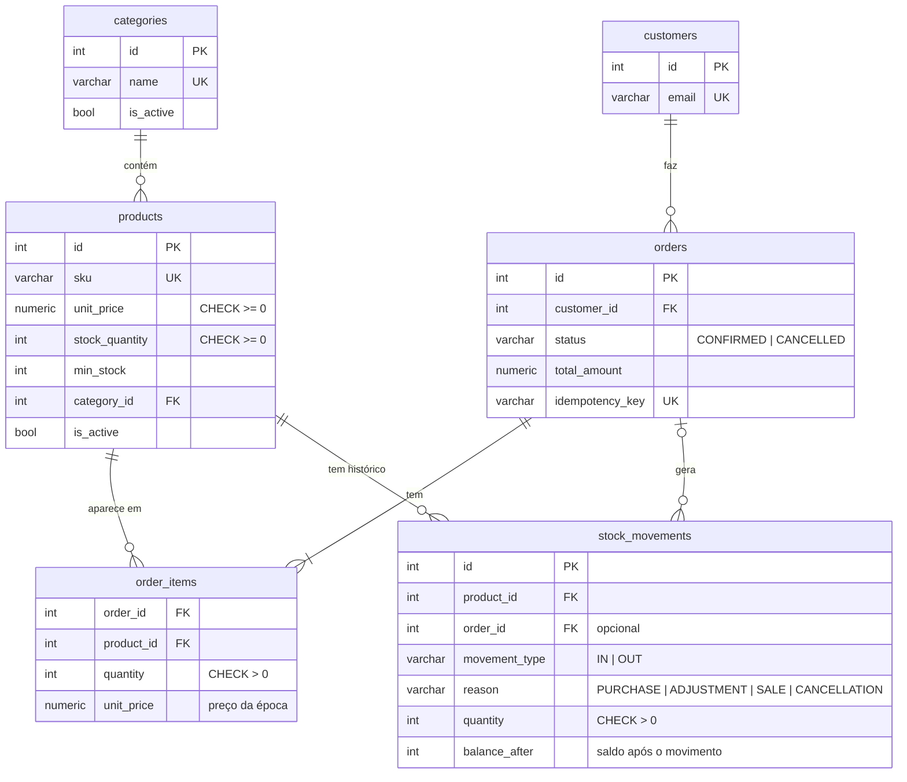

# StockFlow API

[](https://github.com/mattsilveira61/stockflow-api/actions/workflows/tests.yml)


API REST para gestão de produtos, estoque, clientes e pedidos de uma pequena loja.

O foco vai além do CRUD: o projeto trata **integridade dos dados**. O estoque nunca fica negativo, nem quando vários pedidos disputam as últimas unidades ao mesmo tempo. Pedidos e cancelamentos são atômicos e toda mudança de saldo fica registrada num histórico auditável.

**Stack:** Python 3.12 · FastAPI · PostgreSQL 16 · SQLAlchemy 2 · Alembic · Pydantic v2 · pytest · Docker Compose · GitHub Actions

## O que o projeto demonstra

| Problema | Solução |
|---|---|
| Duas compras simultâneas das últimas unidades | `SELECT ... FOR UPDATE` nas linhas dos produtos dentro da transação do pedido |
| Deadlock entre pedidos com os mesmos produtos em ordens diferentes | Os locks são sempre pedidos **em ordem de id** |
| Pedido com um item sem estoque | Valida tudo antes e faz um commit só: ou tudo muda, ou nada muda |
| Cancelamento duplicado devolvendo estoque em dobro | `UPDATE orders SET status='CANCELLED' WHERE id=:id AND status='CONFIRMED'`: só uma requisição consegue mudar a linha |
| Cliente reenvia o mesmo pedido (timeout, clique duplo) | Cabeçalho `Idempotency-Key`: a mesma chave devolve o pedido original (`200` + `Idempotent-Replayed: true`) |
| Preço do produto muda depois da venda | O item guarda o `unit_price` da época; o total é sempre calculado no backend |
| Saldo alterado "por fora" | `stock_quantity` não aceita escrita pela API de produto; só `services/inventory.move_stock` altera o saldo |
| Bug no código deixando saldo negativo | `CHECK (stock_quantity >= 0)` no banco como última linha de defesa |
| Dinheiro com erro de arredondamento | `NUMERIC(12,2)` no banco e `Decimal` no Python, nunca `float` |

Tudo isso é coberto por testes. A concorrência é testada com **10 threads reais** disputando o mesmo estoque (veja [`tests/test_concurrency.py`](tests/test_concurrency.py)).

## Modelo de dados



Nada é apagado fisicamente: produtos e categorias são desativados (`is_active`), o que preserva o histórico de pedidos e movimentações.

## Rodando

### Com Docker (mais simples)

```powershell
copy .env.example .env      # Linux/macOS: cp .env.example .env
docker compose up --build
```

A API sobe em **http://localhost:8000/docs**, já com as migrações aplicadas e os dados de demonstração (8 produtos, 3 clientes). Para não criar os dados de demonstração, use `SEED_DEMO=false` no `.env`.

### Local (para desenvolver)

```powershell
copy .env.example .env
docker compose up -d postgres            # só o banco (porta 5433)
py -3.12 -m venv .venv
.\.venv\Scripts\python.exe -m pip install -r requirements.txt
.\.venv\Scripts\python.exe -m alembic upgrade head
.\.venv\Scripts\python.exe -m app.seed   # opcional: dados de demonstração
.\.venv\Scripts\python.exe -m uvicorn app.main:app --reload
```

### Variáveis de ambiente

| Variável | Para quê |
|---|---|
| `DATABASE_URL` | Conexão do PostgreSQL usada pela API |
| `TEST_DATABASE_URL` | Banco separado para os testes (é **apagado** a cada execução) |
| `API_KEY` | Chave exigida no cabeçalho `X-API-Key` em `POST`/`PATCH` (mínimo 16 caracteres) |
| `POSTGRES_*` | Usuário, senha, banco e porta do contêiner do PostgreSQL |
| `SEED_DEMO` | `false` para não criar os dados de demonstração no Docker |

## Testes

```powershell
.\.venv\Scripts\python.exe -m pytest
```

São 107 testes de integração rodando contra o PostgreSQL real, porque locks e transações não se comportam igual em outros bancos. O banco de teste é recriado aplicando as migrações, o que testa as migrações também. Cada teste roda numa transação desfeita no final; a exceção são os testes de concorrência, que usam conexões reais e limpam os dados depois.

O GitHub Actions roda a suíte inteira a cada push.

## Usando a API

As consultas (`GET`) são públicas. Para criar ou alterar dados, envie a chave no cabeçalho `X-API-Key`. No `/docs`, clique em **Authorize**.

| Método | Rota | Descrição |
|---|---|---|
| `GET` | `/health` | API e banco no ar |
| `GET` `POST` | `/categories` | Listar / criar categorias |
| `GET` `PATCH` | `/categories/{id}` | Consultar / alterar ou desativar |
| `GET` `POST` | `/products` | Listar (busca `q`, filtros, `sort`, paginação) / criar |
| `GET` `PATCH` | `/products/{id}` | Consultar / alterar dados cadastrais ou desativar |
| `GET` `POST` | `/products/{id}/movements` | Histórico / entrada ou saída manual |
| `GET` `POST` | `/customers` | Listar / criar clientes |
| `GET` `PATCH` | `/customers/{id}` | Consultar / alterar |
| `GET` `POST` | `/orders` | Listar (cliente, status, datas) / criar pedido |
| `GET` | `/orders/{id}` | Pedido com itens |
| `POST` | `/orders/{id}/cancel` | Cancelar e devolver o estoque |
| `GET` | `/reports/low-stock` | Produtos ativos no estoque mínimo ou abaixo |

### Exemplos

Os exemplos usam os dados de demonstração. Troque `$KEY` pela sua `API_KEY`.

**Entrada de estoque**

```bash
curl -X POST localhost:8000/products/2/movements \
  -H "X-API-Key: $KEY" -H "Content-Type: application/json" \
  -d '{"movement_type": "IN", "quantity": 30, "reason": "PURCHASE", "note": "NF 4512"}'
```

```json
{ "id": 8, "product_id": 2, "order_id": null, "movement_type": "IN", "reason": "PURCHASE",
  "quantity": 30, "balance_after": 48, "note": "NF 4512", "created_at": "2026-10-14T20:30:00Z" }
```

**Criar pedido (com idempotência)**

```bash
curl -X POST localhost:8000/orders \
  -H "X-API-Key: $KEY" -H "Content-Type: application/json" \
  -H "Idempotency-Key: pedido-0001" \
  -d '{"customer_id": 1, "items": [{"product_id": 1, "quantity": 3}, {"product_id": 4, "quantity": 1}]}'
```

```json
{
  "id": 1, "customer_id": 1, "status": "CONFIRMED", "total_amount": "35.40",
  "items": [
    { "product_id": 1, "sku": "BEB-001", "name": "Água mineral 500 ml", "quantity": 3, "unit_price": "2.50", "subtotal": "7.50" },
    { "product_id": 4, "sku": "MER-001", "name": "Arroz branco 5 kg", "quantity": 1, "unit_price": "27.90", "subtotal": "27.90" }
  ],
  "created_at": "2026-10-14T20:31:00Z", "updated_at": "2026-10-14T20:31:00Z"
}
```

Repetir a mesma requisição devolve o mesmo pedido com status `200` e não baixa o estoque de novo.

**Erro de negócio**

Todos os erros seguem o mesmo formato:

```json
{ "error": { "code": "INSUFFICIENT_STOCK",
             "message": "Estoque insuficiente: LIM-002 (disponível 0, solicitado 1)" } }
```

| Status | Quando |
|---|---|
| `401` | `X-API-Key` ausente ou inválida |
| `404` | Recurso não existe |
| `409` | Regra de negócio: SKU/e-mail repetido, estoque insuficiente, pedido já cancelado, produto desativado |
| `422` | Dados inválidos (`details` traz o campo e o motivo) |
| `500` | Erro inesperado: mensagem genérica, detalhe só no log |

## Estrutura

```text
app/
├── api/routes/     # HTTP: rotas, status codes, documentação
├── schemas/        # Pydantic: validação de entrada e formato de saída
├── services/       # regras de negócio (inventory, orders, catalog, customers)
├── models/         # SQLAlchemy: tabelas, constraints e relações
├── core/           # configuração e erros de negócio
├── db/             # engine e sessão
└── seed.py         # dados de demonstração (idempotente)
alembic/versions/   # migrações versionadas
tests/              # integração com PostgreSQL, incluindo concorrência
```

## Decisões técnicas

- **Lock pessimista em vez de otimista.** Num estoque com disputa pelas últimas unidades, `FOR UPDATE` é mais simples e previsível que retentar conflitos de versão. A transação é curta, então o tempo de espera é pequeno.
- **Validar tudo antes de baixar.** O pedido trava todos os produtos, confere estoque e status de todos e só então altera os saldos. Assim a mensagem de erro lista todos os itens em falta de uma vez.
- **`balance_after` no histórico.** Cada movimentação guarda o saldo resultante, como um extrato bancário, e dá para auditar o saldo atual sem recalcular a soma de tudo.
- **Enums como `VARCHAR + CHECK`.** São mais fáceis de evoluir em migrações que o `ENUM` nativo do PostgreSQL.
- **API key, não JWT.** Para uma API de demonstração, uma chave simples protege as escritas sem o peso de um sistema de usuários. Login com JWT e perfis está no meu outro projeto, o [HelpBoard](https://github.com/mattsilveira61/helpboard).

## Limitações conhecidas

- Uma única chave de API para todas as escritas, sem usuários nem perfis.
- Filtros de data em UTC.
- Pedidos só têm os estados `CONFIRMED` e `CANCELLED`; não há pagamento nem entrega.
