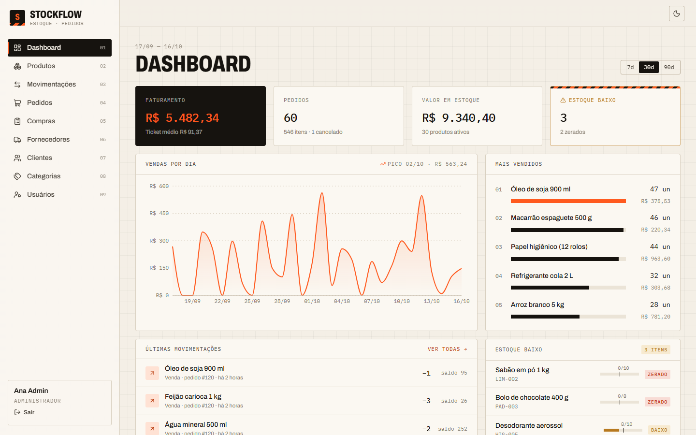
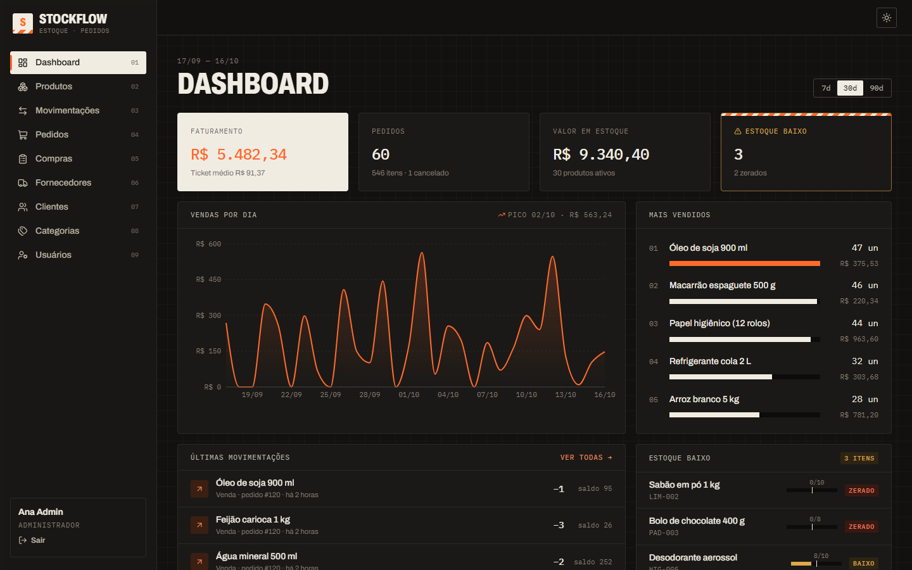
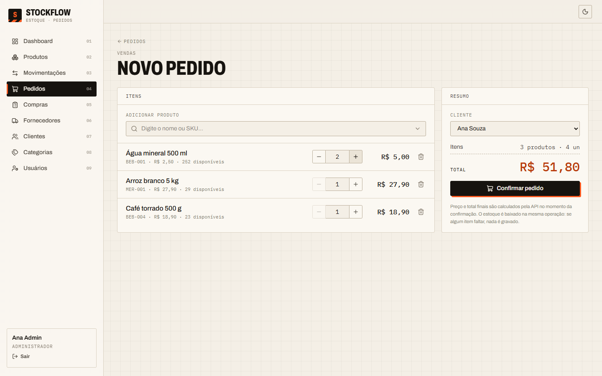
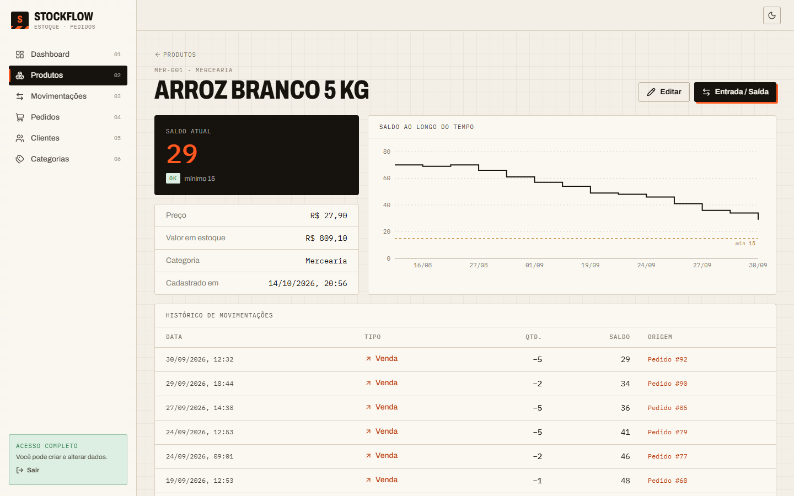
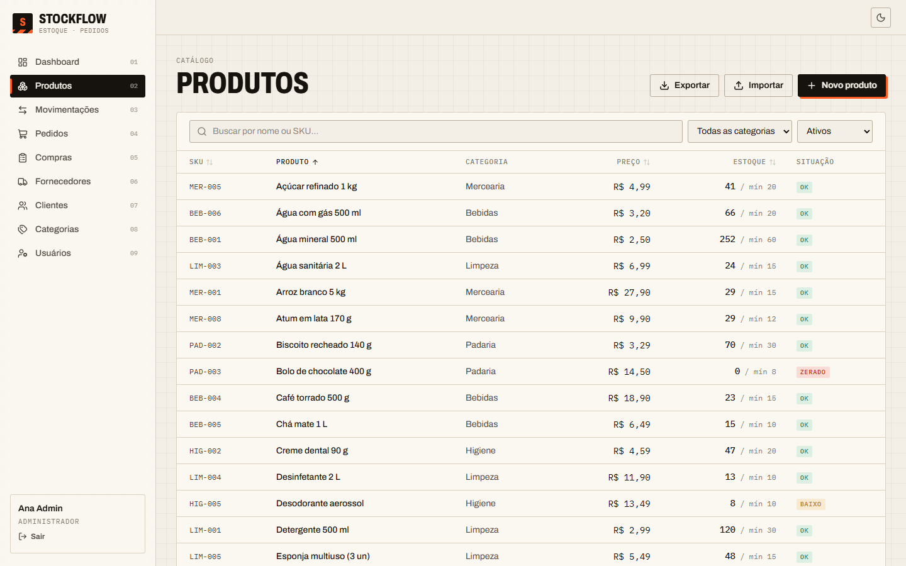
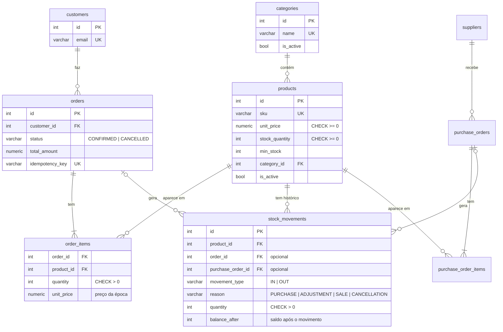

# StockFlow

[](https://github.com/mattsilveira61/stockflow-api/actions/workflows/tests.yml)


Sistema de estoque e pedidos de uma pequena loja: **API REST** em FastAPI + PostgreSQL e **painel web** em React.



O foco vai além do CRUD: o projeto trata **integridade dos dados**. O estoque nunca fica negativo, nem quando vários pedidos disputam as últimas unidades ao mesmo tempo. Pedidos e cancelamentos são atômicos e toda mudança de saldo fica registrada num histórico auditável.

**Back-end:** Python 3.12 · FastAPI · PostgreSQL 16 · SQLAlchemy 2 · Alembic · Pydantic v2 · pytest

**Front-end:** React 19 · TypeScript · Vite · Tailwind CSS 4 · TanStack Query · Recharts · Playwright

**Infra:** Docker Compose (PostgreSQL + API + nginx) · GitHub Actions (pytest + e2e)

## O que o projeto demonstra

| Problema | Solução |
|---|---|
| Duas compras simultâneas das últimas unidades | `SELECT ... FOR UPDATE` nas linhas dos produtos dentro da transação do pedido |
| Deadlock entre pedidos com os mesmos produtos em ordens diferentes | Os locks são sempre pedidos **em ordem de id** |
| Pedido com um item sem estoque | Valida tudo antes e faz um commit só: ou tudo muda, ou nada muda |
| Cancelamento duplicado devolvendo estoque em dobro | `UPDATE orders SET status='CANCELLED' WHERE id=:id AND status='CONFIRMED'`: só uma requisição consegue mudar a linha |
| Cliente reenvia o mesmo pedido (timeout, clique duplo) | Cabeçalho `Idempotency-Key`: a mesma chave devolve o pedido original (`200` + `Idempotent-Replayed: true`) |
| Preço do produto muda depois da venda | O item guarda o `unit_price` da época; o total é sempre calculado no backend |
| Saldo alterado "por fora" | `stock_quantity` não aceita escrita pela API de produto; só `services/inventory.move_stock` altera o saldo |
| Bug no código deixando saldo negativo | `CHECK (stock_quantity >= 0)` no banco como última linha de defesa |
| Mercadoria recebida duas vezes (clique duplo, duas abas) | Pedido de compra com status `DRAFT → ORDERED → RECEIVED`; receber é um `UPDATE ... WHERE status='ORDERED'`: só um recebimento dá entrada no estoque |
| Comprar de novo o que já está a caminho | A sugestão de reposição desconta as compras enviadas e ainda não recebidas |
| Importação de planilha que grava metade e para no meio | Valida o arquivo inteiro antes, grava numa transação só e devolve cada erro com linha e coluna; com `dry_run=true` só mostra o que mudaria |
| CSV exportado executando fórmula ao abrir no Excel | Células que começam com `= + - @` ganham um apóstrofo na exportação |
| Dinheiro com erro de arredondamento | `NUMERIC(12,2)` no banco e `Decimal` no Python, nunca `float` |
| Busca que exige acento ("feijao" não acha "Feijão") | Extensão `unaccent` do PostgreSQL na busca de produtos e clientes |
| "Dia" do relatório no fuso errado (UTC) | Agrupamento e filtros por dia no fuso da loja (`America/Sao_Paulo`) |

Tudo isso é coberto por testes. A concorrência é testada com **10 threads reais** disputando o mesmo estoque (veja [`tests/test_concurrency.py`](tests/test_concurrency.py)).

## Painel web

Interface no estilo de painel administrativo, com tema claro e escuro, que se adapta ao celular.

| | |
|---|---|
|  |  |
| **Dashboard:** faturamento, pedidos, valor em estoque, alertas de estoque baixo, vendas por dia e mais vendidos | **Novo pedido:** busca sem acento, total ao vivo, aviso de item acima do estoque e `Idempotency-Key` automática |
|  |  |
| **Produto:** gráfico do saldo ao longo do tempo (a partir do `balance_after`) e histórico auditável | **Produtos:** busca, filtros e ordenação guardados na URL, com selo de estoque ok/baixo/zerado |

- **Login com perfis:** `LEITOR` só consulta; `OPERADOR` também registra pedidos, movimentações, compras, clientes e fornecedores; `ADMIN` também cuida do catálogo e dos usuários. Os botões que o perfil não pode usar ficam desabilitados com a explicação, mas quem decide é a API (`403`). A tela de login tem um botão para cada usuário de demonstração.
- **Erros da API na tela certa:** "SKU já existe" aparece embaixo do campo SKU, e "estoque insuficiente" aparece no carrinho sem perder os itens.
- **Sem CORS:** o painel chama `/api/...`. No desenvolvimento o Vite repassa para a API; no Docker quem faz isso é o nginx.
- **Compras:** fornecedores, pedidos de compra com sugestão de reposição e recebimento que dá entrada no estoque; cada movimentação mostra de qual compra veio.
- **Planilhas:** exportar produtos e movimentações com os filtros da tela e importar produtos com prévia (novos, atualizados, sem mudança) antes de gravar.
- **Testes e2e** com Playwright cobrindo os fluxos principais: criar produto → entrada → saída recusada; pedido → baixa → cancelamento → devolução; compra → envio → recebimento → entrada; carrinho sem estoque.

## Modelo de dados



Nada é apagado fisicamente: produtos e categorias são desativados (`is_active`), o que preserva o histórico de pedidos e movimentações.

## Rodando

### Com Docker (mais simples)

```powershell
copy .env.example .env      # Linux/macOS: cp .env.example .env
docker compose up --build
```

| Endereço | O quê |
|---|---|
| **http://localhost:5173** | Painel web |
| http://localhost:8000/docs | Documentação interativa da API (Swagger) |

Tudo sobe com as migrações aplicadas e com os dados de demonstração: 30 produtos, 10 clientes e 60 dias de operação simulada (cerca de 120 pedidos), para os gráficos terem o que mostrar. Para não criar os dados de demonstração, use `SEED_DEMO=false` no `.env`.

Usuários de demonstração (senha `DEMO_PASSWORD` do `.env`, `stockflow123` no exemplo):

| E-mail | Perfil | Pode |
|---|---|---|
| `admin@stockflow.dev` | `ADMIN` | Tudo, inclusive catálogo e usuários |
| `operador@stockflow.dev` | `OPERADOR` | Pedidos, movimentações, compras, clientes e fornecedores |
| `leitor@stockflow.dev` | `LEITOR` | Só consulta |

### Local (para desenvolver)

```powershell
copy .env.example .env
docker compose up -d postgres            # só o banco (porta 5433)
py -3.12 -m venv .venv
.\.venv\Scripts\python.exe -m pip install -r requirements.txt
.\.venv\Scripts\python.exe -m alembic upgrade head
.\.venv\Scripts\python.exe -m app.seed   # opcional: dados de demonstração
.\.venv\Scripts\python.exe -m uvicorn app.main:app --reload

# Em outro terminal: o painel com recarga automática (http://localhost:5173)
cd frontend
npm install
npm run dev
```

### Variáveis de ambiente

| Variável | Para quê |
|---|---|
| `DATABASE_URL` | Conexão do PostgreSQL usada pela API |
| `TEST_DATABASE_URL` | Banco separado para os testes (é **apagado** a cada execução) |
| `SECRET_KEY` | Assina os tokens de login (mínimo 32 caracteres) |
| `ACCESS_TOKEN_EXPIRE_MINUTES` | Validade do login (padrão 480, um turno de trabalho) |
| `DEMO_PASSWORD` | Senha dos usuários de demonstração criados pelo seed |
| `POSTGRES_*` | Usuário, senha, banco e porta do contêiner do PostgreSQL |
| `SEED_DEMO` | `false` para não criar os dados de demonstração no Docker |
| `TIMEZONE` | Fuso dos relatórios e filtros por dia (padrão `America/Sao_Paulo`) |

## Testes

```powershell
.\.venv\Scripts\python.exe -m pytest              # API

cd frontend
npm run typecheck; npm run lint                       # painel
npx playwright test                                   # e2e (com a API no ar)
```

**API:** 165 testes de integração rodando contra o PostgreSQL real, porque locks e transações não se comportam igual em outros bancos. O banco de teste é recriado aplicando as migrações, o que testa as migrações também. Cada teste roda numa transação desfeita no final; a exceção são os testes de concorrência, que usam conexões reais e limpam os dados depois.

**Painel:** 25 testes e2e no navegador com Playwright, contra a API e o banco reais, entrando com os usuários de demonstração.

O GitHub Actions roda dois jobs a cada push: `pytest` e o do painel (tipos, lint, build e e2e).

## Usando a API

Tudo exige login (só o `/health` é público). Entre em `POST /auth/login`, e envie o token em `Authorization: Bearer <token>`. No `/docs`, clique em **Authorize** e cole o `access_token`.

| Método | Rota | Descrição |
|---|---|---|
| `GET` | `/health` | API e banco no ar |
| `GET` `POST` | `/categories` | Listar / criar categorias |
| `GET` `PATCH` | `/categories/{id}` | Consultar / alterar ou desativar |
| `GET` `POST` | `/products` | Listar (busca `q`, filtros, `sort`, paginação) / criar |
| `GET` `PATCH` | `/products/{id}` | Consultar / alterar dados cadastrais ou desativar |
| `GET` `POST` | `/products/{id}/movements` | Histórico / entrada ou saída manual |
| `GET` `POST` | `/customers` | Listar / criar clientes |
| `GET` `PATCH` | `/customers/{id}` | Consultar / alterar |
| `GET` `POST` | `/orders` | Listar (cliente, status, datas) / criar pedido |
| `GET` | `/orders/{id}` | Pedido com itens |
| `POST` | `/orders/{id}/cancel` | Cancelar e devolver o estoque |
| `GET` `POST` | `/suppliers` | Listar (busca `q`, `active`) / criar fornecedores |
| `GET` `PATCH` | `/suppliers/{id}` | Consultar / alterar ou desativar |
| `GET` `POST` | `/purchases` | Listar (fornecedor, status) / criar pedido de compra (rascunho) |
| `GET` `PATCH` | `/purchases/{id}` | Compra com itens / editar o rascunho |
| `POST` | `/purchases/{id}/send` | Rascunho → enviado ao fornecedor |
| `POST` | `/purchases/{id}/receive` | Enviado → recebido: dá entrada de todos os itens numa transação |
| `POST` | `/purchases/{id}/cancel` | Cancela rascunho ou enviado (recebido não cancela) |
| `GET` | `/purchases/suggestions` | Sugestão de reposição: produtos abaixo do mínimo, descontando o que está a caminho |
| `GET` | `/products/export.csv` | Produtos em CSV (`;`, vírgula decimal, abre no Excel) com os filtros da listagem |
| `POST` | `/products/import` | Importa CSV: cria SKUs novos e atualiza os existentes, tudo ou nada (`dry_run=true` só confere) |
| `GET` | `/movements/export.csv` | Histórico de movimentações em CSV com os filtros da listagem |
| `GET` | `/reports/low-stock` | Produtos ativos no estoque mínimo ou abaixo |
| `GET` | `/movements` | Histórico geral (produto, tipo, motivo, datas) |
| `GET` | `/dashboard?days=30` | Indicadores, vendas por dia, mais vendidos e últimas movimentações |
| `POST` | `/auth/login` | E-mail e senha → token (5 erros por minuto bloqueiam com `429`) |
| `GET` | `/auth/me` | Usuário dono do token |
| `GET` `POST` | `/users` | Listar / criar usuários (só `ADMIN`) |
| `GET` `PATCH` | `/users/{id}` | Consultar / alterar perfil, senha ou desativar (só `ADMIN`) |

### Exemplos

Os exemplos usam os dados de demonstração. Primeiro, o login:

```bash
TOKEN=$(curl -s -X POST localhost:8000/auth/login -H "Content-Type: application/json" \
  -d '{"email": "operador@stockflow.dev", "password": "stockflow123"}' | jq -r .access_token)
```

**Entrada de estoque**

```bash
curl -X POST localhost:8000/products/2/movements \
  -H "Authorization: Bearer $TOKEN" -H "Content-Type: application/json" \
  -d '{"movement_type": "IN", "quantity": 30, "reason": "PURCHASE", "note": "NF 4512"}'
```

```json
{ "id": 8, "product_id": 2, "order_id": null, "movement_type": "IN", "reason": "PURCHASE",
  "quantity": 30, "balance_after": 48, "note": "NF 4512", "created_at": "2026-10-14T20:30:00Z" }
```

**Criar pedido (com idempotência)**

```bash
curl -X POST localhost:8000/orders \
  -H "Authorization: Bearer $TOKEN" -H "Content-Type: application/json" \
  -H "Idempotency-Key: pedido-0001" \
  -d '{"customer_id": 1, "items": [{"product_id": 1, "quantity": 3}, {"product_id": 4, "quantity": 1}]}'
```

```json
{
  "id": 1, "customer_id": 1, "status": "CONFIRMED", "total_amount": "35.40",
  "items": [
    { "product_id": 1, "sku": "BEB-001", "name": "Água mineral 500 ml", "quantity": 3, "unit_price": "2.50", "subtotal": "7.50" },
    { "product_id": 4, "sku": "MER-001", "name": "Arroz branco 5 kg", "quantity": 1, "unit_price": "27.90", "subtotal": "27.90" }
  ],
  "created_at": "2026-10-14T20:31:00Z", "updated_at": "2026-10-14T20:31:00Z"
}
```

Repetir a mesma requisição devolve o mesmo pedido com status `200` e não baixa o estoque de novo.

**Erro de negócio**

Todos os erros seguem o mesmo formato:

```json
{ "error": { "code": "INSUFFICIENT_STOCK",
             "message": "Estoque insuficiente: LIM-002 (disponível 0, solicitado 1)" } }
```

| Status | Quando |
|---|---|
| `401` | Sem login, ou token inválido, vencido ou de usuário desativado |
| `403` | Perfil sem permissão (ex.: `LEITOR` tentando criar pedido) |
| `404` | Recurso não existe |
| `409` | Regra de negócio: SKU/e-mail repetido, estoque insuficiente, pedido já cancelado, produto desativado |
| `422` | Dados inválidos (`details` traz o campo e o motivo) |
| `500` | Erro inesperado: mensagem genérica, detalhe só no log |

## Estrutura

```text
app/
├── api/routes/     # HTTP: rotas, status codes, documentação
├── schemas/        # Pydantic: validação de entrada e formato de saída
├── services/       # regras de negócio (inventory, orders, catalog, customers)
├── models/         # SQLAlchemy: tabelas, constraints e relações
├── core/           # configuração, fuso horário e erros de negócio
├── db/             # engine e sessão
└── seed.py         # dados de demonstração: 60 dias simulados pelos próprios services (idempotente)
alembic/versions/   # migrações versionadas
tests/              # integração com PostgreSQL, incluindo concorrência
frontend/
├── src/api/        # cliente HTTP, tipos e hooks do TanStack Query
├── src/components/ # layout, tabela, formulários, drawer/modal, ProductPicker, toasts
├── src/pages/      # Dashboard, Produtos, Movimentações, Pedidos, Clientes, Categorias
├── e2e/            # testes Playwright
└── nginx.conf      # serve o build e repassa /api para a API
```

## Decisões técnicas

- **Lock pessimista em vez de otimista.** Num estoque com disputa pelas últimas unidades, `FOR UPDATE` é mais simples e previsível que retentar conflitos de versão. A transação é curta, então o tempo de espera é pequeno.
- **Validar tudo antes de baixar.** O pedido trava todos os produtos, confere estoque e status de todos e só então altera os saldos. Assim a mensagem de erro lista todos os itens em falta de uma vez.
- **`balance_after` no histórico.** Cada movimentação guarda o saldo resultante, como um extrato bancário, e dá para auditar o saldo atual sem recalcular a soma de tudo.
- **Enums como `VARCHAR + CHECK`.** São mais fáceis de evoluir em migrações que o `ENUM` nativo do PostgreSQL.
- **Estado do servidor no TanStack Query.** Cada tela declara o que lê; depois de uma venda ou movimentação, as consultas que dependem do saldo (produtos, dashboard, estoque baixo, histórico) são invalidadas juntas.
- **Filtros na URL.** Busca, filtros, ordenação e página ficam no endereço: recarregar ou compartilhar o link mantém a mesma visão.
- **JWT que guarda só o id do usuário.** O perfil e a situação são lidos do banco a cada requisição: desativar alguém ou trocar o perfil vale na hora, sem esperar o token vencer. A senha usa bcrypt, e o login confere uma senha falsa quando o e-mail não existe, para o tempo de resposta não revelar quem está cadastrado.

## Limitações conhecidas

- O limite de tentativas de login fica na memória da API: vale para uma instância só.
- Lista de clientes no filtro de pedidos e no carrinho limitada a 100 (suficiente para a demonstração).
- Pedidos só têm os estados `CONFIRMED` e `CANCELLED`; não há pagamento nem entrega.
